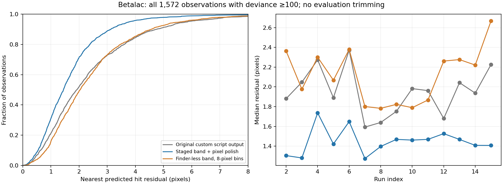

# Betalac staged refinement

`solve --refinement band` implements the betalac reference script's staged
refinement with selectable degrees of freedom. It shares one physical model
between finder observations and signed count residuals. The Poisson/group-L1
solver remains the default. The band objective is an explicit experimental
alternative, not a replacement for that likelihood or a multi-crystal solver.

## Modes and scope

| `--refine-modes` entry | Free parameters |
| --- | --- |
| `cylindrical` | Horizontal detector-position scale |
| `axial_stretch` | Vertical detector-position scale |
| `area` | Shared panel width/height scale |
| `global_rot` | Assembly rotation |
| `global_trans` | Assembly translation |
| `sample` | Sample translation, with vertical component fixed |
| `cell` | Monoclinic a, b and beta, with c fixed |
| `per_run` | Scan correction per run, anchored at the first stable run |
| `panels` | Regularized in-panel du/dv shifts |

All modes are enabled by default. The current scope is 512x512 CG4D flat
panels, beam +z, a monoclinic unique-b cell, and a net vertical goniometer
rotation. Unsupported geometries are rejected. The bootstrap supplies only the
orientation; detector geometry starts from nominal instrument metrology.
With finder observations, the bootstrap can now be omitted: a blind band
search supplies the orientation automatically. See the [blind benchmark](betalac-blind.md).

The stages are stable-run 60-zone multistart, a per-run angle scan, 120-zone
refinement, fine-zone cell refinement, and regularized panel shifts. Optional
pixel polish assigns HKLs once, fits a radial Huber objective, trims once by
per-bank median residual, then refits the same assignments.

The vertical sample/global-detector translation ambiguity is fixed by setting
sample y=0. This leaves the predicted rays unchanged. New CG4D metadata uses
omega polarity -1. Historical HDF5 axes/R are not silently rewritten: the
experiment's preparation script corrects copies explicitly.
The varying encoder in these betalac files is phi; omega is fixed at zero.
The results JSON now reports corrections from that varying column, correcting
an earlier reporting error that displayed the fixed omega column as zeros.
The fitted corrections themselves were already applied to the correct axis.

## Reproduction

Data, original script/results, intermediates, logs and an independent evaluator
are preserved separately in `/home/xvg/subhkl-examples/betalac-5`. Its
`REPRODUCE_GUIDE.txt` records the local environment and commands. From there:

```bash
python -m subhkl.io.parser solve work/merged.h5 work/peaks.h5 \
  --refinement band --bootstrap source/indexer_spherical.h5 \
  --finder-peaks work/finder.h5 --pixel-polish --d-min 2.0 \
  --runs 2,3,4,5,6,7,8,9,10,11,12,13,14,15 \
  --stable-runs 2,3,4,5,6,7,8,9 --band-maxiter 2000

python -m subhkl.io.parser solve work/merged.h5 work/counts.h5 \
  --refinement band --bootstrap source/indexer_spherical.h5 \
  --binning 8 --static-mask-file source/mask.h5 --d-min 2.0 \
  --runs 2,3,4,5,6,7,8,9,10,11,12,13,14,15 \
  --stable-runs 2,3,4,5,6,7,8,9 --band-maxiter 1200
```

The integration band defaults to 2.85–4.35 A, matching the script; prediction
and assignment use 2.8–4.5 A. Both have explicit CLI options. Finder comparison
defaults to deviance >=100. Count input has no signal threshold, local maxima
or connected-component detection: every fully instrument-valid bin contributes
its signed excess over a local median background. Fourier sums and derivatives
are chunked to bound memory. The 32-pixel trial aliased the band objective and
failed; 8-pixel binning recovered the correct geometry/scan-drift basin.

## Numerical corrections

The reference script's unassigned hkl=0 rows divide by |G|² when forming the
Ewald wavelength. Masking those rows later does not remove NaNs from automatic
differentiation; the reproduced pixel stages returned a NaN objective without
taking a step. The implementation guards this division and ray intersections.
It represents the same radial Huber data objective using two residual
coordinates per observation, then uses bounded trust-region least squares with
JAX derivatives and physical parameter scaling. Preserving both coordinates
avoids losing transverse curvature at nearly exact spots.

The panel penalty remains `200 * sum(du² + dv²)` (shifts in metres) during
polish. The script reduced it to 0.05, which allowed one poorly constrained
panel to hit its 8 mm bound once the pixel optimizer actually moved. This
intentional prior change is included in the reported comparison.

Each completed stage saves parameters and optimizer status to a sibling
`.stages.h5`. The final `scan_refinement` group records modes, runs, bounds,
provenance, and statuses; assignments, trimming and pixel residuals are retained
when requested. Iteration-limit or bound-hitting final fits are diagnostic:
they do not export usable `sample/U`. Their candidates can still be displayed
with the existing finder-free visualizer. Output replacement is atomic.

## Interpretation

The independent evaluator uses the nearest forward predicted hit on the
observed panel, within 2.8–4.5 A and d_min 2.0 A. It includes all observations
at each deviance threshold, without the fit's trimming. Under that common
protocol the original saved reference has a 1.92 px median at deviance >=100;
this differs from the guide's reported 1.65 px. Compare the measured results
in [betalac-results.json](betalac-results.json), rather than mixing protocols.

Both final checkpoint-based fits converged without hitting parameter bounds.
At deviance >=100, the regularized peak fit has median **1.45 px** with **96.9%**
within 2 sigma; count-only refinement has median **2.04 px** with **92.3%**
within 2 sigma. A separate full CLI peak run, without checkpoint replay, also
converged to the same fit. A count-output zone overlay rendered successfully.
The count-only fit recovered the late-run approximately 3.7-degree slip using
2,796,272 valid count bins. Early failed/unconverged trials are retained.

The count experiment starts from the spherical-index orientation and does not
use finder coordinates or pixel polish. It establishes **seeded finder-less
refinement**, not fully blind finder-less indexing. The expanded modes are not
yet implemented in the Poisson/L1 refinement. Similar pixel predictions also
do not independently establish the physical accuracy of every geometry
parameter; their correlations remain relevant.


